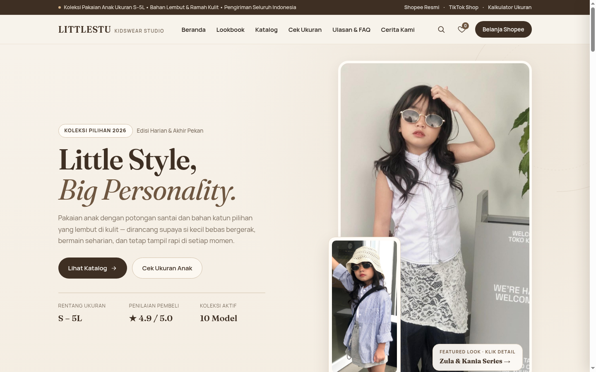
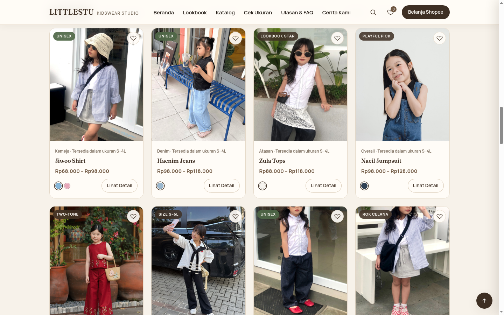
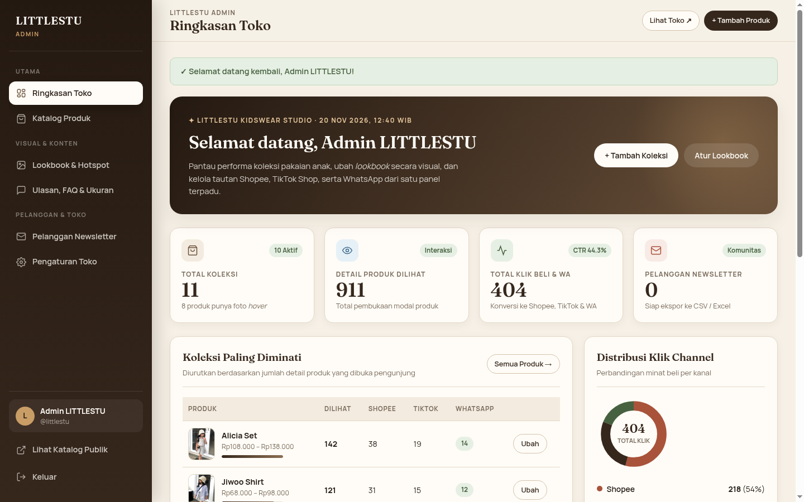

# LITTLESTU (CodeIgniter 4)

Online catalog and admin panel for the LITTLESTU kidswear store, built with CodeIgniter 4 and MySQL/MariaDB. Visitors can browse products, check the lookbook with product hotspots, use the size calculator, and open purchase links on Shopee, TikTok Shop, or WhatsApp.

## Screenshots

Storefront homepage:



Product catalog:



Admin dashboard:



## Note on product images

Product photos in `public/images/` are intentionally omitted from this repository, with only `placeholder.svg` kept as a fallback. To populate product photos, upload them through the admin panel or place your image files inside `public/images/`.

## Features

Storefront:
- Product catalog with category filtering, search, and color previews
- Lookbook slides with clickable hotspots linked to product details
- Kid size calculator based on age, height, and weight
- Customer reviews, FAQs, and newsletter signup
- Click and view tracking for Shopee, TikTok Shop, and WhatsApp links

Admin panel (`/admin`):
- Store overview with top viewed products and click breakdown by channel
- Product management (create, edit, toggle active status, delete)
- Lookbook and hotspot coordinate editor
- Management for reviews, FAQs, size guides, and store copy settings
- Newsletter subscriber list with CSV export

## Requirements

- PHP 8.2 or higher with `intl`, `mbstring`, and `mysqli` extensions enabled
- Composer
- MySQL or MariaDB

## Getting started

1. Install PHP dependencies:
   ```bash
   composer install
   ```

2. Copy `env` to `.env`, then set `app.baseURL` and your database credentials:
   ```ini
   app.baseURL = 'http://localhost:8080/'

   database.default.hostname = 127.0.0.1
   database.default.database = littlestu
   database.default.username = root
   database.default.password =
   database.default.DBDriver = MySQLi
   database.default.port = 3306
   ```

3. Create an empty MySQL/MariaDB database, then run the migrations and seeder:
   ```bash
   php spark migrate
   php spark db:seed LittlestuSeeder
   ```

4. Start the local development server:
   ```bash
   php spark serve
   ```
   If port `8080` is already in use, specify another port:
   ```bash
   php spark serve --port=8081
   ```

The storefront runs at `http://localhost:8080` and the admin login page is at `http://localhost:8080/admin/login`.

## Default admin account

`LittlestuSeeder` creates one default admin account:

- Username: `littlestu` (or email `admin@littlestu.id`)
- Password: `admin`

Change this password before deploying to production.
